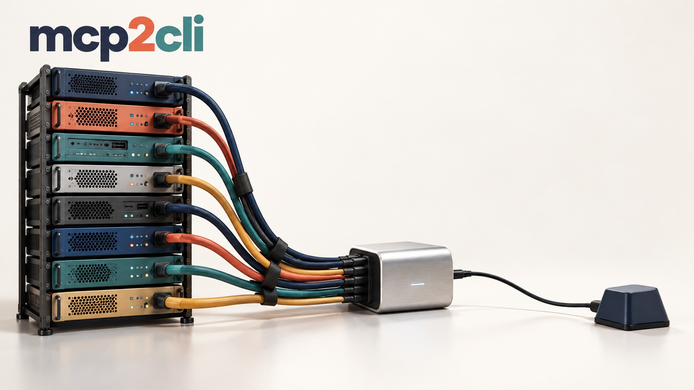
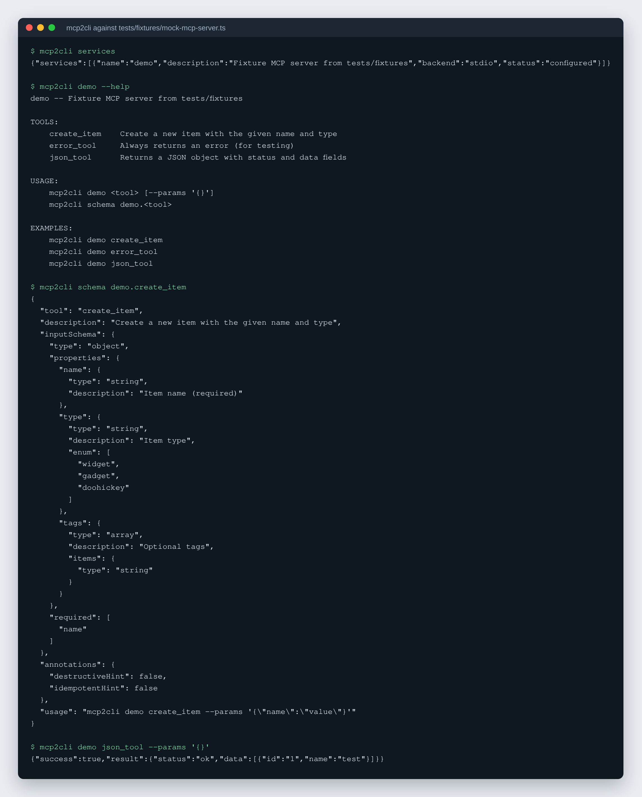
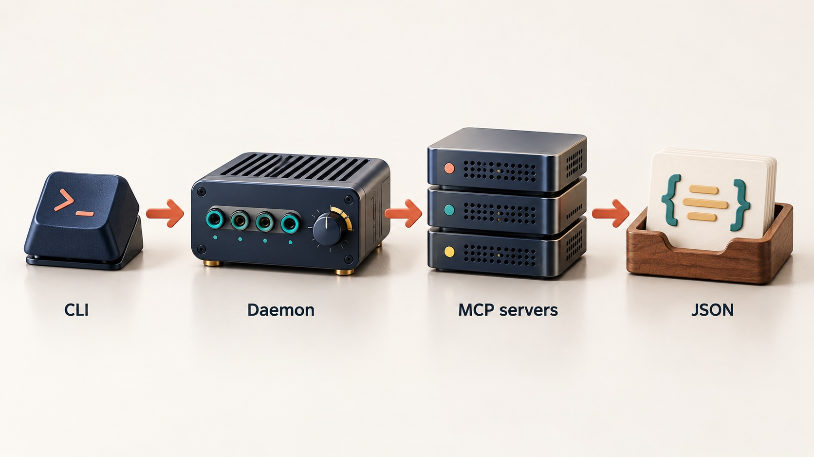

# mcp2cli

Call any MCP server's tools from bash, so an AI agent loads a tool's schema only when it needs that tool.

[](LICENSE)




## What it is

mcp2cli is a command-line bridge for the Model Context Protocol (MCP). It reads
a `services.json` of MCP servers (stdio, HTTP or WebSocket) and exposes every
tool as a shell command:

```bash
mcp2cli <service> <tool> --params '{"key": "value"}'
```

Output on stdout is always JSON, errors carry semantic exit codes, and a
background daemon keeps server connections warm between calls.



*Real output: mcp2cli run against the mock MCP server in `tests/fixtures/mock-mcp-server.ts`.*

## Why it exists

An agent harness that registers MCP servers directly puts every tool definition
from every server into the model's context on every turn, whether or not the
tools are used. With several servers that is a large, permanent cost in
context window. mcp2cli moves the tools behind a bash command: the agent lists
services, reads the one schema it needs with `mcp2cli schema`, and calls the
tool. The idea follows [Google Workspace CLI](https://github.com/googleworkspace/cli),
which wrapped large APIs as plain commands.

## How it works



The CLI (`src/cli`) validates the service name, tool name and parameters
(`src/validation`) before anything is dispatched, and serves schemas from a
local cache (`src/cache`) when they are fresh. Tool calls go through the daemon
client (`src/process/client.ts`) to a local daemon over a Unix socket, or to a
shared network daemon over HTTP when `MCP2CLI_REMOTE_URL` is set. The daemon
(`src/daemon/server.ts`) authenticates the caller, applies per-identity
credentials, and takes a connection from a pool (`src/daemon/pool.ts`) guarded
by a circuit breaker. It exits after an idle timeout, and in network mode it
exposes `/health`, Prometheus `/metrics` and an audit log.

## Features

- One command shape for every MCP tool: `mcp2cli <service> <tool> --params '{...}'`.
- `mcp2cli schema <service>.<tool>` returns one tool's input schema on demand.
- stdio, HTTP and WebSocket MCP backends; `mcp2cli bootstrap` imports the
  `mcpServers` block from `~/.claude.json`.
- Persistent daemon with a connection pool, health checks, idle exit and a
  circuit breaker per service.
- Network mode: one daemon serves many machines, with bearer tokens, RBAC
  roles, per-identity and per-group credentials, and Prometheus metrics.
- Input validation against path traversal, control characters, prototype
  pollution and deep nesting.
- Schema cache with drift detection, cross-service tool search, batch calls
  from NDJSON, `--dry-run`, field filtering, and `--format` json, table, yaml,
  csv or ndjson.
- `generate-skills` writes agent skill files from live tool schemas.

## Quick start

Requires [Bun](https://bun.sh) 1.0 or later.

```bash
git clone https://github.com/rodaddy/mcp2cli.git
cd mcp2cli
bun install
bun run build                      # produces dist/mcp2cli
ln -sf "$PWD/dist/mcp2cli" ~/.local/bin/mcp2cli

mcp2cli bootstrap                  # import MCP servers from ~/.claude.json
mcp2cli services                   # list configured services
mcp2cli <service> --help           # list a service's tools
mcp2cli schema <service>.<tool>    # read one tool's schema
mcp2cli <service> <tool> --params '{}'
```

Run from source without building: `bun run dev -- services`.
Run the tests: `bun test`.

The full command, configuration, authentication and deployment reference is in
[docs/REFERENCE.md](docs/REFERENCE.md). A systemd unit and environment template
for the network daemon are in [`deploy/`](deploy/).

## Project status

Active. It is used every day on its author's own machines as the way several
coding agents (Claude Code, Codex, chat bots) reach their MCP servers, through
both the local CLI path and the network daemon. It has not been run by other
teams or at larger scale. It is not an MCP registry, it does not sandbox the
servers it launches, and `${secret:...}` references resolve through a
Vaultwarden-backed service you run yourself.

## Licence

MIT. See [LICENSE](LICENSE).

## Credits

- [Model Context Protocol TypeScript SDK](https://github.com/modelcontextprotocol/typescript-sdk)
- [Google Workspace CLI](https://github.com/googleworkspace/cli), the model for the command shape.

## Author

Rico Rojas, https://rico-rojas.com
